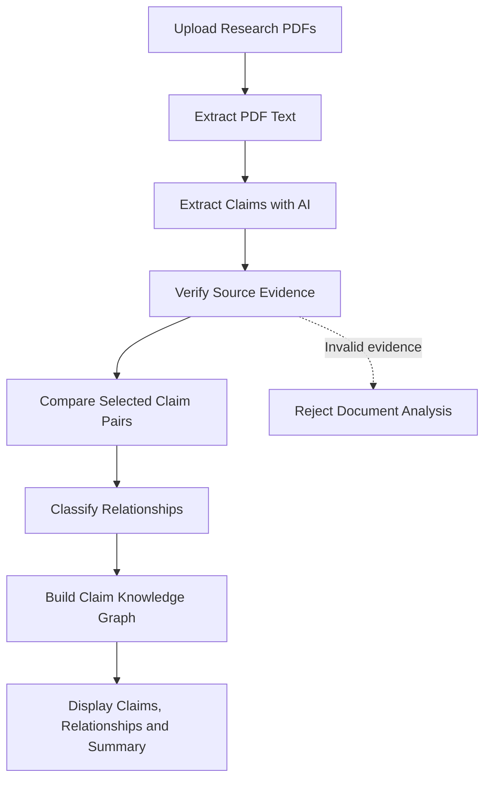
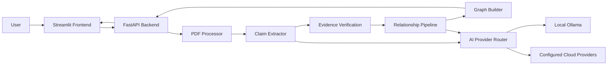

# ClaimGraph AI

### Evidence-Based Research. Connected Claims. Transparent Analysis.

**Turn isolated research papers into traceable, connected claims.**

🌐 **Live Demo:** [Try ClaimGraph AI]([YOUR_STREAMLIT_APP_URL](https://claimgraph-frontend-3bezcappddnyvpeag9pj384.streamlit.app/))

⚙️ **Backend API:** [ClaimGraph API](https://claimgraph-ai.onrender.com)

📖 **API Documentation:** [Explore the API]([https://claimgraph-ai.onrender.com/docs](https://claimgraph-ai.onrender.com/docs?utm_source=chatgpt.com))

💻 **Backend Repository:** [claimgraph-ai]([https://github.com/Wizard52007/claimgraph-ai](https://github.com/Wizard52007/claimgraph-ai?utm_source=chatgpt.com))

💻 **Frontend Repository:** [claimgraph-frontend](https://github.com/Wizard52007/claimgraph-frontend)

---

**ClaimGraph AI** is an AI-powered research analysis tool that extracts factual claims from research papers, verifies them against their original source text, and identifies relationships between claims across documents.


# claimgraph-ai
Evidence-based claim analysis and contradiction detection across documents
# ClaimGraph AI

### Evidence-Based Research. Connected Claims. Transparent Analysis.

**ClaimGraph AI** is an AI-powered research analysis tool that extracts factual claims from research papers, verifies them against their original source text, and identifies relationships between claims across documents.

Instead of treating research papers as isolated blocks of text, ClaimGraph transforms their claims into a connected knowledge graph—helping users explore supporting evidence, contradictions, qualifications, and relationships between research findings.

> **Our goal:** Make research easier to compare, evidence easier to trace, and relationships between scientific claims easier to understand.

---


## Overview

Research often involves reading multiple papers, extracting important findings, checking their supporting evidence, and determining how different studies relate to one another. Doing this manually can be time-consuming and makes cross-document analysis difficult.

ClaimGraph AI aims to simplify this process through an evidence-first pipeline that combines PDF text extraction, local or cloud-based language models, evidence verification, relationship classification, and graph construction.

Upload two or more PDF documents and let ClaimGraph analyze their claims and connections.

## Key Features

- **Multi-document analysis** — Analyze two or more PDF documents in a single request.
- **AI-powered claim extraction** — Extract meaningful factual claims from individual document pages.
- **Evidence verification** — Check extracted evidence against the original page text before accepting a claim.
- **Source traceability** — Preserve document names, page numbers, and supporting evidence for extracted claims.
- **Relationship classification** — Classify selected claim pairs as `SUPPORTS`, `CONTRADICTS`, `QUALIFIES`, `UNRELATED`, or `INSUFFICIENT_EVIDENCE`.
- **Knowledge graph construction** — Represent extracted claims as nodes and their relationships as edges.
- **Local AI inference** — Run supported models through Ollama, reducing dependence on paid cloud APIs.
- **Multi-provider AI routing** — Support configured providers such as Ollama, Google Gemini, OpenAI, Groq, and OpenRouter.
- **REST API** — Expose document analysis through a FastAPI endpoint.
- **Automated testing** — Validate core functionality using pytest.

## How It Works



### Processing Pipeline

1. **Document ingestion:** Accept multiple PDF files through the frontend or API.
2. **Text extraction:** Extract page-level text using PyMuPDF.
3. **Claim extraction:** Use a configured language model to identify factual claims and their supporting text.
4. **Evidence verification:** Verify that the quoted evidence exists in the original page text, allowing harmless whitespace differences.
5. **Relationship analysis:** Use AI to classify selected cross-document claim pairs.
6. **Graph generation:** Construct a graph containing claims and their classified relationships.
7. **Results:** Return claims, evidence, relationships, graph nodes and edges, and a summary.

**Evidence-first design:** A claim is not accepted merely because the model generates a plausible statement. Its supporting evidence must be traceable to the source text.

## Relationship Types

| Relationship | Meaning |
|---|---|
| `SUPPORTS` | One claim provides evidence consistent with another. |
| `CONTRADICTS` | Two claims conflict on a relevant, comparable fact. |
| `QUALIFIES` | One claim adds context, a limitation, or a qualification to another. |
| `UNRELATED` | The claims have no meaningful evidential relationship. |
| `INSUFFICIENT_EVIDENCE` | Available information does not justify a reliable classification. |

These labels describe the relationship between selected claims; they do not automatically establish whether an entire research paper is correct or incorrect.

---

## System Architecture

ClaimGraph AI is organized into a frontend and a backend.



### Backend Modules

| Module | Responsibility |
|---|---|
| `api.py` | FastAPI endpoints and document-analysis orchestration |
| `claimgraph/pdf_processor.py` | Extract text from PDF documents |
| `claimgraph/claim_extractor.py` | Extract factual claims and verify evidence |
| `claimgraph/gemini_client.py` | Route generation requests to configured AI providers |
| `claimgraph/comparison_pipeline.py` | Select and process claim pairs |
| `claimgraph/relationship_analyzer.py` | Classify relationships between claims |
| `claimgraph/graph_builder.py` | Construct the claim relationship graph |
| `claimgraph/models.py` | Define structured claim and relationship models |

### Technology Stack

| Component | Technology |
|---|---|
| Frontend | Python, Streamlit |
| Backend | Python, FastAPI |
| API validation | Pydantic |
| PDF processing | PyMuPDF |
| AI inference | Ollama and supported cloud providers |
| Graph construction | NetworkX |
| Testing | pytest |
| API documentation | FastAPI / Swagger UI |

---

## Getting Started

### Prerequisites

Install or prepare the following:

- Python 3.12 or compatible Python version
- Git
- Ollama, if using a local language model
- The ClaimGraph backend and frontend repositories

### 1. Clone the repositories

**Backend**

```bash
git clone https://github.com/Wizard52007/claimgraph-ai.git
cd claimgraph-ai
```

**Frontend**

Clone the frontend repository separately into a directory alongside the backend. Replace the placeholder below with your actual frontend repository URL.

```bash
git clone https://github.com/Wizard52007/claimgraph-frontend.git
```

### 2. Set up the backend

Create and activate a virtual environment.

**Windows PowerShell**

```powershell
python -m venv .venv
.\.venv\Scripts\Activate.ps1
```

Install the project dependencies:

```powershell
python -m pip install -r requirements.txt
```

### 3. Configure the AI provider

For local inference, install Ollama and download the model:

```powershell
ollama pull qwen2.5:3b
```

Make sure Ollama is running and the model is available:

```powershell
ollama list
```

Create a `.env` file in the backend root directory:

```env
USE_OLLAMA=false

OLLAMA_MODELS=qwen2.5:3b
OLLAMA_BASE_URL=http://localhost:11434

GEMINI_API_KEY=
OPENAI_API_KEY=
GROQ_API_KEY=
OPENROUTER_API_KEY=
```

Keep `USE_OLLAMA=false` while running the existing provider-router tests. Enable it in the application terminal when you want to use local Ollama.

For example:

```powershell
$env:USE_OLLAMA="true"
$env:OLLAMA_MODELS="qwen2.5:3b"
$env:OLLAMA_BASE_URL="http://localhost:11434"
```

Alternatively, configure a supported cloud provider by supplying its API key and model settings.

**Security:** Never commit `.env` files, API keys, or other secrets to GitHub.

### 4. Start the backend

From the backend directory:

```powershell
uvicorn api:app --reload
```

The API will be available at:

- Base URL: `http://127.0.0.1:8000`
- Health check: `http://127.0.0.1:8000/health`
- Interactive API documentation: `http://127.0.0.1:8000/docs`

### 5. Start the frontend

Open a second terminal:

```powershell
cd path/to/claimgraph-frontend
```

Install the frontend dependencies if a requirements file is provided:

```powershell
python -m pip install -r requirements.txt
```

Start Streamlit:

```powershell
python -m streamlit run app.py
```

Open `http://localhost:8501` in your browser.

For local development, configure the frontend to send analysis requests to:

```text
http://127.0.0.1:8000/analyze
```

**Note:** Run the backend and frontend in separate terminals. Local Ollama inference requires Ollama to be available on the machine running the backend.

---

## API Reference

### `GET /health`

Checks whether the backend is running.

**Example response**

```json
{
  "status": "healthy"
}
```

### `POST /analyze`

Analyzes two or more uploaded PDF documents.

**Request**

- Content type: `multipart/form-data`
- Field: `files`
- Value: Two or more PDF files

**Example using Python**

```python
import requests

url = "http://127.0.0.1:8000/analyze"

with open("paper_a.pdf", "rb") as paper_a, \
     open("paper_b.pdf", "rb") as paper_b:

    response = requests.post(
        url,
        files=[
            ("files", ("paper_a.pdf", paper_a, "application/pdf")),
            ("files", ("paper_b.pdf", paper_b, "application/pdf")),
        ],
        timeout=900,
    )

response.raise_for_status()
result = response.json()

print(result["summary"])
```

The timeout shown here is a client-side example, not a guarantee that every analysis will finish within that period.

**Successful response structure**

```json
{
  "claims": [
    {
      "claim_id": "paper_a_claim_001",
      "text": "Example factual claim",
      "document_name": "paper_a.pdf",
      "page_number": 1,
      "evidence_text": "Exact supporting passage from the document."
    }
  ],
  "relationships": [],
  "graph": {
    "nodes": [],
    "edges": []
  },
  "summary": {
    "document_count": 2,
    "claim_count": 1,
    "relationship_count": 0,
    "potential_contradictions": 0
  }
}
```

The example illustrates the response structure; actual claims, relationships, identifiers, and counts depend on the uploaded documents.

**Error handling**

The API may return errors when:

- Fewer than two documents are uploaded.
- A file is not a PDF or cannot be processed.
- No claims are extracted.
- Evidence cannot be verified.
- AI generation or subsequent analysis fails.

Consult the API response and backend logs for details.

---

## Running Tests

From the backend root directory, activate the virtual environment and run:

```powershell
python -m pytest tests/
```

The test suite covers components including:

- AI provider routing and fallback
- Claim extraction
- Evidence-related extraction behavior
- Comparison pipeline
- Graph construction
- Data models
- PDF processing
- Relationship analysis

Tests should be run with the relevant provider settings configured for the test environment. Local Ollama should be disabled unless a test explicitly requires it.

---

## Performance and Current Limitations

ClaimGraph AI is an evolving prototype. Its performance and analytical coverage depend on document length, text quality, model selection, and available computing resources.

Current implementation considerations:

- PDF processing relies on extractable text; scanned documents may require OCR.
- Claim extraction currently processes non-empty pages individually.
- Evidence verification checks source text, including whitespace-normalized matching. It does not establish that a quoted passage scientifically proves the claim.
- Relationship analysis is limited to a maximum of three claim comparisons per analysis in the current configuration.
- Consequently, the generated graph represents selected relationships, not necessarily every relationship in the documents.
- Smaller local models may generate faster responses but can differ in extraction quality and JSON reliability.
- Model outputs require validation and should not be treated as definitive scientific judgments.

These limitations are important when interpreting results or using ClaimGraph for research.

---

## Roadmap

Potential areas for future development include:

- [ ] More efficient claim extraction and inference batching
- [ ] OCR support for scanned research papers
- [ ] Semantic candidate matching before relationship analysis
- [ ] Configurable comparison limits
- [ ] Improved progress reporting for long-running analyses
- [ ] Interactive graph exploration and filtering
- [ ] Exportable claim and evidence reports
- [ ] Citation-aware evidence navigation
- [ ] Evaluation against manually labelled research-document pairs
- [ ] Improved handling of tables, figures, and scientific notation

The roadmap represents planned improvements, not necessarily features available in the current version.

---

## Example Use Cases

ClaimGraph AI is designed for workflows such as:

- **Literature reviews:** Compare findings reported by multiple studies.
- **Scientific research:** Trace claims back to the text that supports them.
- **Fact analysis:** Identify potentially conflicting statements across documents.
- **Research synthesis:** Explore how claims support, qualify, or relate to one another.
- **Academic learning:** Help students navigate multiple papers more systematically.

## Contributing

Contributions, bug reports, and feature suggestions are welcome.

1. Fork the repository.
2. Create a feature branch.
3. Make your changes and add relevant tests.
4. Run the test suite.
5. Submit a pull request describing the changes.

Please avoid committing credentials, private research documents, or other sensitive data.

## Responsible Use

ClaimGraph AI is intended to assist research and document analysis. Its output is not a substitute for reading the original sources, evaluating research methodology, or exercising scientific judgment.

A detected relationship does not by itself establish causation, scientific consensus, or the truth of a claim. Users should verify important findings against the original documents.

## License

This project is licensed under the **MIT License**.

You are free to use, copy, modify, merge, publish, distribute, sublicense, and sell copies of the software, subject to the conditions of the license.

See the [`LICENSE`](LICENSE) file for the full license text.

## Acknowledgements

Built with Python, FastAPI, Streamlit, PyMuPDF, NetworkX, pytest, and the language models and providers supported by the project.

---

**ClaimGraph AI — From isolated research papers to traceable, connected claims.**
